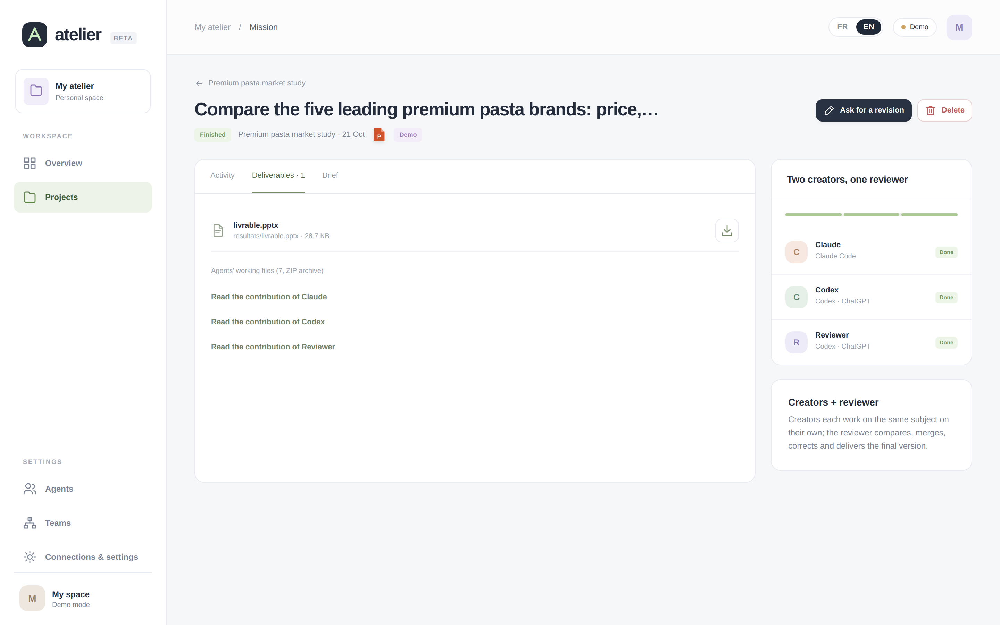
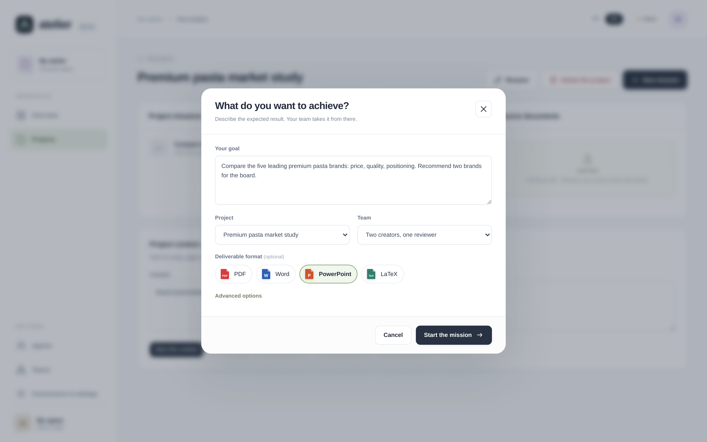
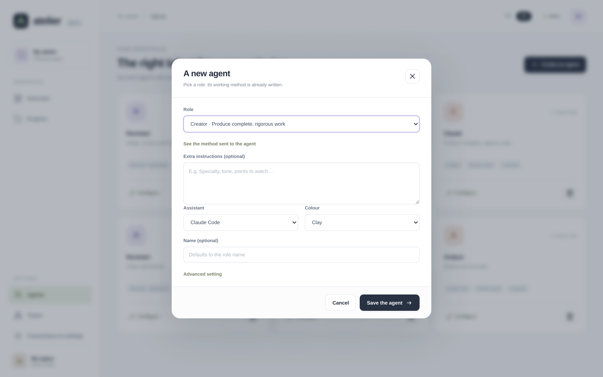
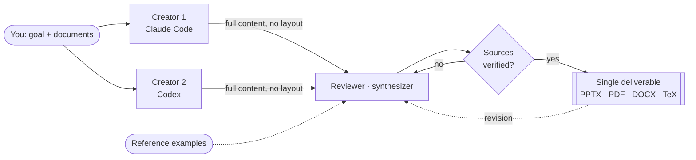
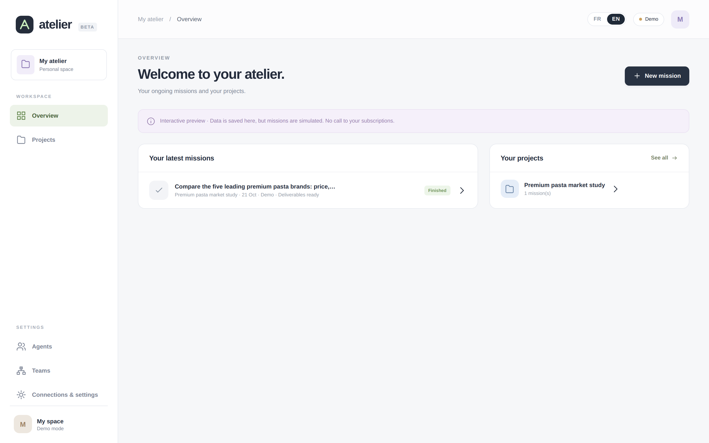

<div align="center">


# Atelier

**Build teams of AI agents (Claude Code, Codex, Gemini) and hand them missions, from a web dashboard hosted on your own virtual machine.**

[](https://github.com/Maxime-Skryma/atelier-agents/actions/workflows/tests.yml)




</div>

---

Atelier turns the subscriptions you already pay for (Claude, ChatGPT, Google) into a small working team. You describe a goal and pick a team; two *creator* agents work independently, then a *reviewer* compares, merges, corrects and delivers **a single file** in the format you asked for: PowerPoint, PDF, Word or LaTeX.

Everything runs on your VM: your documents, missions and deliverables stay on the machine, apart from what the assistants exchange with their own services.

> **Languages:** the interface is available in English and French (switch in one click, detected from your browser on first use). Deliverables are written in the language you choose; the instructions sent to the agents are in English.

## Contents

- [Features](#features)
- [How a team works](#how-a-team-works)
- [Installation](#installation)
- [Getting started](#getting-started)
- [Security and limits](#security-and-limits)
- [Architecture](#architecture)
- [Development](#development)

## Features

| | |
|---|---|
| **Predefined roles** | *Creator* (complete, rigorous, sourced work) and *Reviewer · synthesizer* (compares, merges, corrects, delivers). Or write your own instructions. |
| **Mixed teams** | Up to 6 agents, as *creators + reviewer* (recommended), relay or parallel. Mixing assistants keeps them from repeating each other’s mistakes. |
| **One deliverable** | Only the final agent handles layout: one consistent visual identity, then a visual check of the result (rendered to images, overflows fixed). |
| **Reference design level** | Upload a deck or report you consider well made: the final agent receives page previews and aims at least that high. |
| **Revisions** | Revise a finished mission in one sentence: only the final agent picks the deliverable up again. |
| **Projects and context** | Source documents per project, optional project context, global context for every mission. |
| **Verified sources** | Every cited link, DOI or arXiv ID is checked without AI; a missing source is sent back to the agent for correction. Figures and quotations must appear in the page or document cited next to them; figures with no source are flagged. Paywalled articles are listed so you can add them yourself. |
| **Inspected deliverable** | Atelier opens the final file itself: empty slides, elements off the slide, overflowing text, missing images, leftover placeholders (“TODO”, “[à compléter]”) or the wrong language are sent back to the final agent. |
| **Live follow-up** | Activity log, notes added mid-mission, approval between steps, pause, resume, stop. |
| **Demo mode** | A fully simulated run, with no call to any assistant. |
| **English or French** | The whole interface and the deliverables follow your language choice. |

<table>
<tr>
<td width="50%"><p align="center"><sub>A mission: a goal, a project, a team, a format.</sub></p></td>
<td width="50%"><p align="center"><sub>An agent: a role whose method is already written.</sub></p></td>
</tr>
</table>

## How a team works



Creators never see each other’s work, so their proposals stay independent. They supply all the material (written content, sourced figures, tables, outline, ideas for visuals); the reviewer alone designs the final file.

## Installation

Three options:

| | For | Isolation |
|---|---|---|
| **[A. Docker](#a-docker-recommended)** (recommended) | your computer or a VPS with Docker | the container |
| **[B. VM with `start.sh`](#b-vm-with-startsh-debian-ubuntu-onyxia)** | a dedicated Debian/Ubuntu VM, Onyxia | the VM |
| **[C. Demo mode](#c-demo-mode)** | a quick look, nothing to connect | none needed: no assistant is called |

All options need at least one subscription: Claude (Pro or Max), ChatGPT (Plus or Pro), or Google (for Gemini · Antigravity). Assistants use **your subscriptions**, never API keys: Atelier passes them only a short allow-list of environment variables, with no API key.

### A. Docker (recommended)

Requires Docker Engine with the Compose plugin (Docker Desktop on macOS and Windows). A step-by-step guide in French is in [docs/installation-docker.pdf](docs/installation-docker.pdf).

```bash
git clone https://github.com/Maxime-Skryma/atelier-agents.git
cd atelier-agents
docker compose build                     # 10–20 min the first time
docker compose run --rm atelier init     # choose the dashboard password (12 characters minimum)
docker compose up -d
```

Open <http://localhost:8765/>. The port is published on `127.0.0.1` only: on a VPS, open it through an SSH tunnel (`ssh -L 8765:127.0.0.1:8765 user@your-vps`) or a HTTPS reverse proxy, with `ATELIER_PUBLIC_URL` set in a `.env` file next to `docker-compose.yml`.

Instead of `init`, you can put `ATELIER_PASSWORD=…` in `.env` for the first start; it is hashed into `data/settings.json`, and you should then remove it from `.env`.

**Connect the assistants** (sessions are stored in volumes, never in the image):

```bash
docker exec -it atelier claude           # then /login
docker exec -it atelier codex login --device-auth   # a code to enter in your browser
```

Use `--device-auth` for Codex: its default login waits for a callback on the container’s own `localhost`, which your browser cannot reach.

Gemini · Antigravity is optional: install `agy` inside the container following Google’s documentation, keep its binary in `/opt/agy/bin` (a volume), then sign in with `docker exec -it atelier agy`. Finally, check **Connexions & réglages › Vérifier les connexions**.

**Volumes** (Docker named volumes, local to the host):

| Volume | Mounted on | Content |
|---|---|---|
| `atelier-data` | `/data` | database, missions, documents, password hash, logs |
| `claude` | `/home/atelier/.claude` | Claude Code session |
| `codex` | `/home/atelier/.codex` | Codex session |
| `gemini` | `/home/atelier/.gemini` | Antigravity session |
| `agy` | `/opt/agy` | `agy` binary |

Keep `atelier-data` on a local disk: SQLite runs in WAL mode and must not sit on a network share. Compose prefixes volume names with the project folder (e.g. `atelier-agents_atelier-data`).

**Back up `data/`** (stop the service first so the database is consistent):

```bash
docker compose stop
docker run --rm -v atelier-agents_atelier-data:/data -v "$PWD":/backup debian:bookworm-slim \
  tar czf /backup/atelier-data-$(date +%F).tar.gz -C /data .
docker compose start
```

**Update:** `git pull && docker compose up -d --build`. Data and logins are kept.

Build options: `--build-arg WITH_LATEX=0` for a smaller image without XeLaTeX (no PDF deliverables), `CLAUDE_CODE_VERSION` and `CODEX_VERSION` to pin the assistants’ versions. Memory, CPU and process limits are set in `docker-compose.yml` (`mem_limit`, `cpus`, `pids_limit`).

### B. VM with `start.sh` (Debian, Ubuntu, Onyxia)

#### Requirements

- A **Debian or Ubuntu** Linux VM with Python 3.11+ (`python3-venv`) and sudo access (for LibreOffice).
- **A dedicated VM**: agents can run code on the machine (see [Security](#security-and-limits)).

#### 1. Get it and start it

```bash
git clone https://github.com/Maxime-Skryma/atelier-agents.git
cd atelier-agents
bash scripts/start.sh
```

On first run, the script:

1. creates the Python environment and installs Gunicorn and Pandoc (`requirements.txt`);
2. installs whatever is missing: LibreOffice and Poppler (previews, visual checks), XeLaTeX through Quarto when available (PDF), `python-pptx` and `python-docx` (files built by agents), Claude Code and Codex;
3. asks for a dashboard password (12 characters minimum);
4. starts the service in the background on `127.0.0.1:8765`.

Run the same command after the VM restarts: it only reinstalls what is missing.

#### 2. Open the dashboard

The server only listens on the machine itself. From your computer, open an SSH tunnel:

```bash
ssh -L 8765:127.0.0.1:8765 user@your-vm
```

then open <http://localhost:8765/>.

Behind an HTTPS proxy or a remote VS Code, pass the public address to the script: `bash scripts/start.sh 'https://your-address/proxy/8765/'`. On **Onyxia** (SSP Cloud) it is detected automatically: see [docs/installation-onyxia.md](docs/installation-onyxia.md).

#### 3. Connect the assistants

In a terminal on the VM, log in to the ones you will use:

| Assistant | Installation | Login |
|---|---|---|
| Claude Code | automatic (`start.sh`) | `claude`, then `/login` |
| Codex | automatic (`start.sh`, via npm) | `codex login` |
| Gemini · Antigravity | `agy` CLI, install it following Google’s documentation | `agy`, then sign in with Google |

Then check **Connexions & réglages › Vérifier les connexions**.

### C. Demo mode

To try it without connecting anything, with no password and no assistant called:

```bash
python3 -m pip install -r requirements.txt
python3 server.py --demo --data /tmp/atelier-demo
```

It starts a simulated demo on <http://127.0.0.1:8765/> (local machine only). With Docker, any mission can also be launched with the **demo** execution: a simulated run, without any quota used.

## Getting started

1. **Agents**: create two *Creators* (ideally on two different assistants) and one *Reviewer*.
2. **Teams**: group them as *Creators + reviewer*; the reviewer is moved last automatically.
3. **Projects**: create a project (a title is enough), add your documents and, if useful, some context.
4. **Connexions & réglages**: optionally upload an example deck or report you like.
5. **New mission**: describe the goal, pick the format, launch. Follow the activity, then download the deliverable or ask for a revision.



## Known issues

- **Onyxia: the link sometimes opens VS Code first.** The Onyxia proxy (code-server) checks your VS Code session before forwarding to Atelier; when that session cookie is missing or expired, it shows VS Code instead. Reload the Atelier link once the VS Code tab has loaded and it opens normally.
- **Mission log language.** Log entries are written in the language active when they happen; switching language does not translate past entries.

## Security and limits

Atelier is designed for **a single trusted user on a dedicated VM or container**. Read this before installing:

- **Agents act on the machine.** Codex runs without its sandbox (`danger-full-access`), because the sandbox does not work in most containers. It can run commands with your permissions. Claude Code has no terminal (file read and write, and web only); Antigravity is limited to the mission folder, with no terminal and no web.
- **With Docker, the container is the isolation boundary.** Codex can read and write everything the `atelier` user can inside the container: the data volume and the assistants’ sessions included, but not the application code (read-only) nor the host’s files, since no host folder and no Docker socket is mounted. The container runs as a non-root user, without extra capabilities (`cap_drop: ALL`, `no-new-privileges`), with memory, CPU and process limits. It still shares the host’s kernel: it is less watertight than a VM, and a kernel flaw could let code escape it. Agents also have full network access.
- **Listening address.** On a VM, the server listens on `127.0.0.1` only. In the container it listens on all of the container’s interfaces, and `docker-compose.yml` publishes the port on the host’s `127.0.0.1` only: do not change that mapping to `0.0.0.0` without a HTTPS proxy in front.
- **Real read-only mode.** A read-only mission locks its working folder on disk and rejects the result if any file changed.
- **Protected dashboard.** Hashed password (PBKDF2-SHA256, 600,000 iterations), `HttpOnly` and `SameSite=Strict` session cookie, CSRF check through a header and the origin, reachable from the machine itself only.
- **Assistant sessions.** Atelier never reads, copies or keeps Claude, Codex or Google sessions: it only checks that one exists.
- **Web access.** For personal use, agents ignore `robots.txt` files and “no automated access” notices, but never bypass a subscription, a login or a captcha.
- **Quotas.** Every mission uses your subscription quotas. At most two missions run at the same time.

## Architecture

```
atelier-agents/
├── server.py               # WSGI app: SQLite storage, API, missions, prompts, assistant launch
├── formats.py              # Output formats, PowerPoint and Word templates, Pandoc conversion, previews
├── verification.py         # Deterministic source checks (links, DOI, arXiv, files), figures and quotations
├── inspection.py           # Deterministic checks on the deliverable file (PPTX, DOCX, PDF, TeX)
├── antigravity_adapter.py  # agy command, stream-json protocol, permissions, read-only lock
├── i18n.py                 # Interface language (English or French)
├── requirements.txt        # Gunicorn and Pandoc (bundled)
├── Dockerfile              # Container image: tools, assistants' CLIs, non-root user
├── docker-compose.yml      # Service, port on 127.0.0.1, volumes, limits
├── static/                 # UI: app.js with no framework or build step, style.css, index.html
├── scripts/
│   ├── start.sh            # Install and start on a VM (onyxia.sh: alias)
│   ├── reload.sh           # Reload without downtime after a code change
│   └── docker-entrypoint.sh  # Container start: dashboard password, Gunicorn
├── tests/                  # unittest, simulated assistants, no call to a real model
├── docs/                   # Onyxia and Docker guides, screenshots
├── AGENTS.md               # Guidelines for contributors and coding assistants (CLAUDE.md links here)
└── data/                   # Your data (created at startup, never committed)
```

- **Back end**: standard-library Python plus Gunicorn (1 worker, 8 threads). No external database: SQLite in WAL mode.
- **Front end**: a single JavaScript file, with no dependency or build step.
- **Assistants**: called through their command-line tools, non-interactively, each in its own working folder.
- **Deliverables**: the file built by the final agent when it can, otherwise a Pandoc conversion with a house template (or yours).

## Development

```bash
.venv/bin/python -m unittest discover -s tests   # offline tests
node --check static/app.js                       # UI syntax check
bash scripts/reload.sh                           # tests + service reload
```

Contribution guidelines, including for coding assistants, are in [AGENTS.md](AGENTS.md) (in French). Every visible string exists in both languages: `t('français', 'English')` in `static/app.js`, `L('français', 'English')` in Python. Agent instructions are written in English only.

## License

[MIT](LICENSE) © 2026 Maxime
